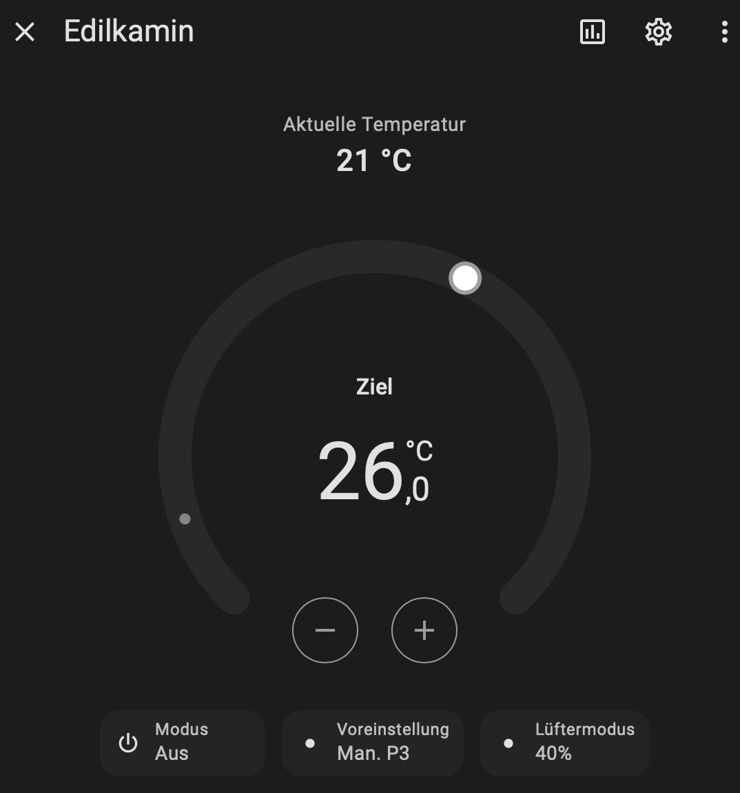
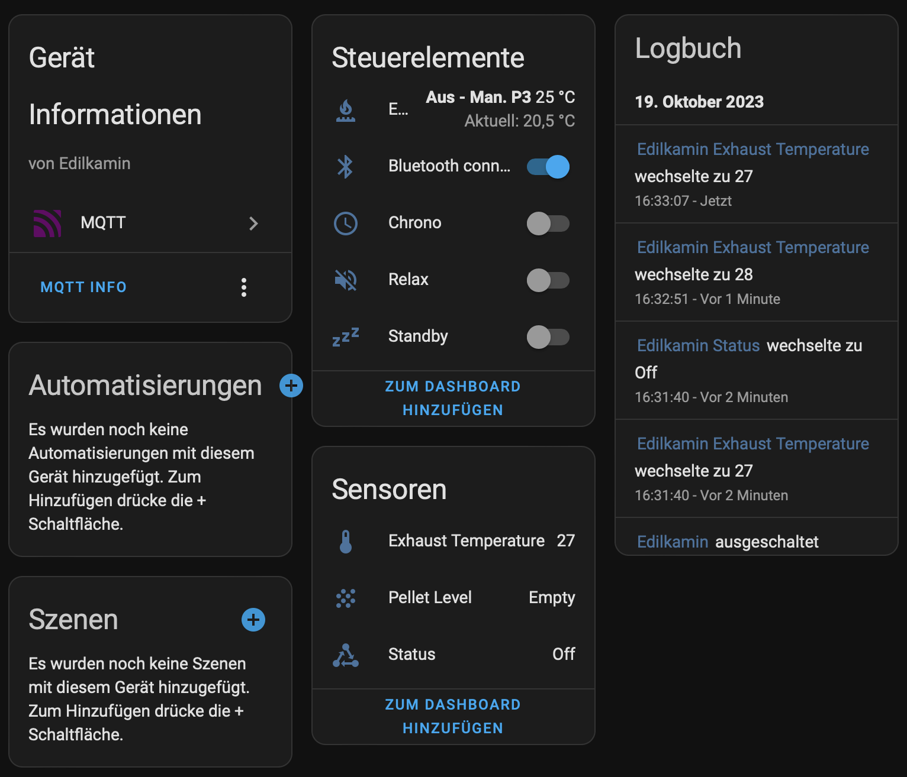
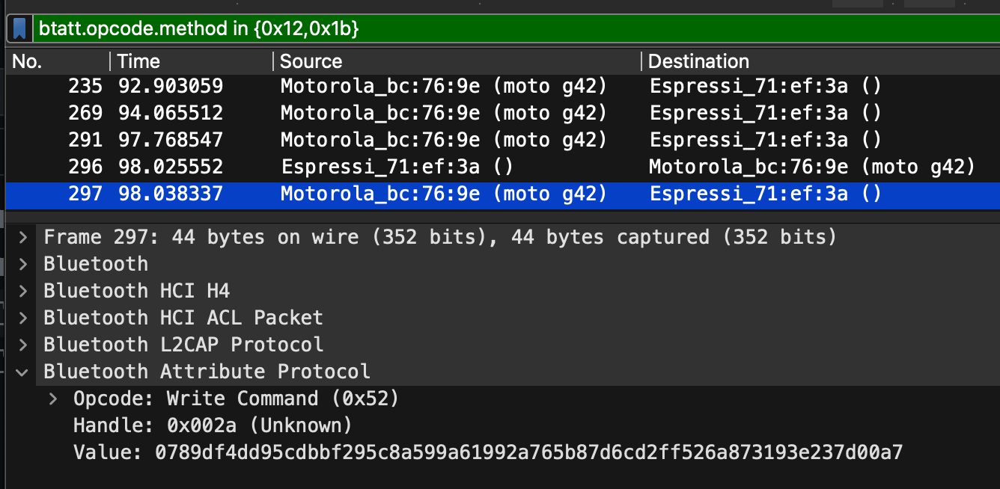
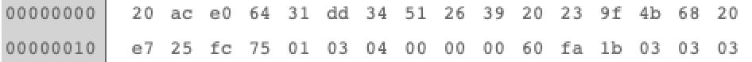

# Edilkamin_BT:

This Arduino-ESP32 project allows to connect to Edilkamin pellet stoves via Bluetooth and automatically integrate it in Home Assistant. The cloud dependency is thus eliminated. 

As the Bluetooth debug has shown, the payload is AES encrypted. Fortunately the necessary keys were found in the source code of the app ;-)

I wrote the code for my Slide2 7-UP pellet stove, but actually all stoves from Edilkamin should work, which are controlled via "The mind".

## Status

This fork implements the **Enhanced** specification, starting with the P0
scope (v1.1 *Reliability* + v1.2 *Diagnostics*): an explicit BLE state
machine, a traceable command lifecycle with read-back verification, frame
validation (CRC/padding/key), three-level availability in Home Assistant
(ESP online / BLE connected / data fresh), runtime log levels with remote
log access, and a full set of diagnostic entities. Topic names and Home
Assistant entity ids from the original firmware are preserved.

See `docs/`:

| Document | Content |
|----------|---------|
| [installation.md](docs/installation.md) | flashing, first configuration, building, running the tests |
| [configuration.md](docs/configuration.md) | every configuration key, portal fields, runtime controls |
| [mqtt-api.md](docs/mqtt-api.md) | topics, payloads, command results, diagnostics, HA entities |
| [architecture.md](docs/architecture.md) | modules, BLE state machine, command lifecycle |
| [troubleshooting.md](docs/troubleshooting.md) | remote diagnosis without USB |
| [migration.md](docs/migration.md) | what changes when upgrading from v0.x |
| [compatibility.md](docs/compatibility.md) | stoves, registers, coexistence with the app |
| [validation.md](docs/validation.md) | hardware test scenarios |
| [spec-gap-analysis.md](docs/spec-gap-analysis.md) | requirement-by-requirement coverage (French) |

## Installation:

!! Webflash currently only works with Wemos D1 Mini ESP32 !!

Install the firmware with the following URL: https://netmb.github.io/Edilkamin_BT/webflash/

Please ensure that the boot button on the ESP32 is pressed when establishing the USB connection.
If everything has worked, you should see an initial configuration Wi-Fi network called "Edilkamin_BT_AP". Connect to it and enter the connection parameters (Wi-Fi, MQTT, NTP, timezone, optionally the stove's BLE MAC). After the reset, the ESP32 will attempt to connect to the stove. Do not forget that the stove must be put into pairing mode when connecting for the first time! You will then find a new device in Home Assistant.

 

Build from source: `pio run -e wemos_d1_mini32` (unit tests: `pio test -e native`).

## Current limitations:

Currently only fan 1 can be changed, because the reference Slide2 does not have more fans. Some special functions like the Chrono timer programme or AirKare are not exposed yet (the registers are documented in `src/protocol/Registers.h` but not validated).

Tested on a Slide2 7-UP only; all stoves controlled via "The Mind" should work. Feedback (status codes, register behaviour) is welcome.

## Bluetooth protocol details:

Here is an example of a packet sent from the phone to the stove:

Service-UUID is "abf0", the phone sends write-commands to UUID "abf1", the response from the stove comes in at UUID "abf2".

This is an response from the stove to the phone:

As you can see the payload is always 32 bit long. The payload is AES encrypted. 

The decrypted payload looks like this (write from phone to stove):

The first 4 bytes is the actual timestamp. The next 16 Bytes is a static-key which never changes. The next 6 Bytes is the "real" payload - these are modbus-commands. Followed by 2 bytes CRC (0x84 0x41) and 4 bytes padding (0x04).

The response from the stove looks like this:

First 4 bytes is the timestamp, followed by the 16 bytes "static key". The next 7 bytes are the "real" modbus-response, followed by 2 bytes CRC (0xfa 0x1b) and 3 bytes padding (0x03). CRC is CRC16-Modbus.

There are mainly two modbus command-types: "query" and "set". Query always starts with "0x01 0x03", set starts with "0x01 0x06".

